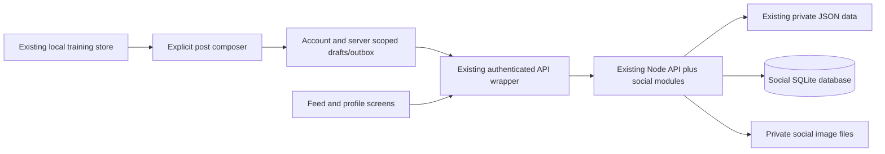

# openSocialGym social expansion plan

Status: Phases 1–4 are implemented locally. Validation and release limitations
are recorded in [Social profiles](SOCIAL_PROFILES.md) and [Friends and blocking](SOCIAL_FRIENDS.md).
Workout publication is documented in [Workout posts](SOCIAL_POSTS.md). The Following
feed, reporting and export are documented in [Timeline](SOCIAL_TIMELINE.md).
Phase 5 local deployment tooling is implemented; container, hosting and native-phone
release gates remain pending. See [Deployment and operations](SOCIAL_DEPLOYMENT.md).
Prepared: 2026-11-06.
Repository baseline: `8fb98b16861a2728652302a7e6e30c50548493a0` on `main`.

## 1. Outcome and initial scope

Extend this fork so people on the same custom openSocialGym server can create a
profile, follow friends, and explicitly publish completed workouts to a timeline,
optionally with a photo selected from their library or taken with their camera.
Keep workout tracking usable offline. Connecting an account to a compatible
server is required for social features, but local training remains available.

Recommended first release:

- One community per server; accounts and follows belong to that server.
- Profiles with a unique handle, display name, avatar, and short bio.
- Member search by handle/display name, follow/unfollow, follower/following lists.
- A chronological Following feed containing the viewer's and followed members'
  visible posts; profile pages list that member's visible posts.
- An optional post composer after workout completion and from workout history.
- A caption, explicit audience, workout preview, and at most one optional photo.
- Edit caption/audience/photo and delete a post; update the workout snapshot only
  through an explicit republish action.
- Blocking, reporting, and an administrator takedown mechanism before inviting
  people outside a small trusted test group.

Likes and comments are implemented. Defer notifications, direct messages, video posts, algorithmic
recommendations, contact-book discovery, federation between servers, and public
unauthenticated links. These are separate extensions, not required for the
requested profile/follow/share flow. Use Hevy as a behavior reference without
copying its assets or interface.

## 2. What the repository already provides

These findings come from the checked-out source, not assumptions about upstream.

| Existing piece | Location | How to extend it |
|---|---|---|
| React, Vite, React Router, Zustand frontend | `frontend/package.json`, `frontend/src/App.jsx`, `frontend/src/store/useStore.js` | Add social screens and a separate social store |
| Android/iOS Capacitor shells | `frontend/android/`, `frontend/ios/` | Verify upload and camera UX on actual phones |
| Plain `node:http` API and route table | `api/server.js` | Register social routes through small dedicated modules |
| Passkeys, optional passwords, cookies, paired-phone bearer sessions | `api/server.js`, `api/device-link.js`, `frontend/src/lib/api.js` | Reuse authenticated account IDs; do not build another login system |
| Server address and pairing UI | `frontend/src/views/MobileOnboarding.jsx`, `frontend/src/components/ServerSync.jsx` | Add capability-aware social onboarding |
| Private per-user training documents and revision-based sync | `api/server.js`, `api/sync-stamps.js`, `frontend/src/lib/sync-merge.js` | Leave the private sync contract intact |
| Saved workout builder | `frontend/src/lib/finish-workout.js` | Derive a safe post snapshot from a finished session |
| Finish summary and existing export/share actions | `frontend/src/sheets.jsx` (`FinishSummary`, `doFinishWorkout`) | Add an independent Share to feed action after saving |
| Private workout photos/videos | `frontend/src/components/WorkoutMedia.jsx`, `frontend/src/lib/workout-media.js` | Reuse picker/ingest primitives, with explicit selection for publication |
| Camera capture pattern for form videos | `frontend/src/components/SetVideo.jsx` | Adapt the camera/library choice for still photos and test platform behavior |
| Media processing, local storage, upload and GC | `frontend/src/lib/media-ingest.js`, `frontend/src/lib/media-sync.js`, `api/media.js` | Add a separate social asset lifecycle and access policy |
| Container deployment | `docker-compose.yml`, `api/Dockerfile`, `web/` | Extend existing deployment and persistent backup coverage |
| API contract and tests | `api/openapi.yaml`, `api/test/`, frontend colocated tests | Extend existing test conventions and route/spec parity |

The server currently keeps account information in `db.json`, private training in
`state-<uid>.json`, and media under `uploads/<uid>/`. Its `publicUser` helper is a
session representation, not a social profile API. Existing media reads resolve
only inside the authenticated owner's directory. A hash is not permission to
read another person's image. Do not loosen those routes to enable feed images.

## 3. Product behavior and privacy rules

### Profiles and following

Create a social profile only when a signed-in member opts in. Existing accounts
receive no public profile or posts during migration. Keep the new handle separate
from the existing login name; do not change authentication identifiers when a
display name changes. Reserve handles case-insensitively, with a documented ASCII
format (proposed: 3–30 letters, numbers, and underscores) and reserved system names.
Validate display name and bio lengths; render them as text.

For the MVP, profiles are discoverable to authenticated members of the same
instance and following is immediate. An opt-in screen must explain this.
Private accounts and follow-request approval can follow later. An avatar is
visible to members who may see the profile; blocking prevents profile discovery,
following, posts, and associated social media access in both directions.

### Post audience and content

Offer `followers` and `members` audiences, defaulting to `followers`. `members`
means signed-in members of this server, never the public internet. Followers means
the current follow relationship, checked at read time; authors can always read
their own posts. Unfollowing, blocking, deletion, and audience changes take effect
on subsequent API and asset requests. Previously viewed/downloaded content cannot
be recalled; avoid persistent shared caches for restricted assets.

Posts contain a versioned, explicitly allowed workout snapshot: workout title,
date, duration, exercise names, completed sets, weights/reps/times/distances with
units, and optional aggregate summaries derived from those fields. Reuse existing
workout-model and total helpers so warmups, side sets, holds, and cardio are
represented correctly. Snapshot custom exercise names so another user does not
need access to the author's private exercise definitions.

Exclude body weight, raw health/heart-rate data, private notes, gym/location, routine
internals, progress photos, and form videos by default. Do not serialize `S` or
the complete workout object into a post. Show the exact proposed contents before
publication. Attaching a private workout photo to the training record does not
automatically attach it to a post.

Saving, importing, syncing, or finishing a workout must never automatically
publish it. Editing training history does not silently change an existing post.
Deleting a workout offers a clear choice about its post; retaining a post keeps
its independent snapshot. Account deletion removes the profile, graph edges,
posts, assets, and pending social work through an idempotent cleanup workflow.

### Completion and offline flow

1. Finish and save the workout using the current path, including watch completion.
2. Show the saved summary with **Share to feed** and **Done**. Never make saving
   depend on a network request or opening the composer.
3. If disconnected/local-only, explain the server requirement and offer the existing
   connection/pairing flow. Preserve the workout and any draft through that flow.
4. Composer shows the preview, caption, audience, and **Choose photo** / **Take photo**.
5. Allow preview, crop/orientation correction, replacement, and removal of the photo.
6. Publish only after explicit confirmation. Show pending/failed/published states.
7. If offline, retain a draft. A publish intent explicitly confirmed by the user
   may retry when connected; a draft alone must never publish automatically.

Persist drafts and publish intents under `(server identity, account ID, workout
ID)`, separately from the private training document. Never send an old account's
queued post after signing into another account or switching servers. Provide
retry and cancel, and handle expired sessions and removed source workouts.

## 4. Proposed architecture

Keep one server/application deployment. Add a relational store for the social
graph, posts, and assets instead of reading every user's private JSON document to
build feeds. Recommend SQLite for a single-server MVP: transactions, uniqueness,
indexes, and no additional database service. Keep account IDs linked to existing
authentication while leaving training JSON unchanged. PostgreSQL becomes a later
option if multiple API replicas or measured load require it.

Before implementation, run a short storage spike against the exact Node version
in `api/Dockerfile` and the supported development runtime. Decide whether built-in
`node:sqlite` is acceptable there or a maintained SQLite driver is needed; record
runtime support, flags, dependency/build impact, transactions, and backup behavior
in an architecture decision. The plan does not assume the driver's API or declare
SQLite production-ready without that check. Use versioned migrations and one API
writer deployment initially; no shared SQLite database on a network filesystem.

The JSON account store and SQLite cannot share a transaction. Create social
profiles only for a currently valid account; use a durable deletion marker and
retryable cleanup for account removal. At startup reconcile orphaned social rows
against valid account IDs without publishing anything. Keep a deletion in progress
inaccessible even if file cleanup fails. Test crashes between each storage step.

Suggested modules (new paths are proposals):

- `api/social/{store,migrations,profiles,follows,posts,policy,media,routes}.js`
- `frontend/src/lib/{social-api,social-snapshot,social-outbox,social-photo}.js`
- `frontend/src/store/useSocialStore.js`
- `frontend/src/views/{Feed,Profile,FindPeople}.jsx`
- `frontend/src/components/{PostCard,PostComposer,ProfileEditor,SocialGate}.jsx`

Keep frontend HTTP transport in `lib/api.js` (including bearer/cookie handling,
origin restrictions, and error behavior); `social-api.js` wraps domain calls.
Do not merge server-owned feeds/follows into `S` or its whole-document sync.
Clear social caches on identity/server changes and invalidate on block/delete.

Expose versioned capabilities from `/api/config`, for example
`social: { version: 1, enabled: true, photos: true, audiences: [...] }` plus
configured limits. Hide/disable publication on old or disabled servers, with a
clear connection state. Feature enablement does not make existing training public.

### Data model

| Entity | Main fields and constraints |
|---|---|
| `social_profiles` | Existing account ID (unique), unique normalized handle, display name, bio, avatar asset ID, created/updated timestamps |
| `follows` | Follower ID, followed ID, created timestamp; unique pair, reject self-follow |
| `posts` | ID, author ID, source workout ID, snapshot schema version, snapshot JSON, caption, audience, created/updated timestamps, revision |
| `assets` | Opaque ID, owner ID, purpose (avatar/post), MIME, dimensions, byte size, private storage key, lifecycle state, created timestamp |
| `post_assets` | Post ID and asset ID; enforce one image per post in the MVP |
| `blocks` | Blocker ID and blocked ID; unique pair, policy checks both directions |
| `reports` | Reporter ID, target post/profile ID, reason, status, timestamps |
| `publish_requests` | Author ID, idempotency key, request digest, result post ID; unique author/key |

Add indexes for feed ordering `(author_id, created_at, id)`, both directions of
the follow graph, handle lookup, and asset references. Initially allow one active
post per `(author, source workout ID)`; retries from two devices resolve to the
existing post rather than duplicates. Use post revisions for concurrent updates.
Use server timestamps for feed order and stable `(created_at, id)` cursor
pagination. Never scan private `state-*.json` for profile statistics or feeds.

### API surface (proposed)

All social endpoints require existing authenticated membership. Public profile
responses use an explicit field projection and never expose login credentials,
email, passkeys, private state, or administration details.

| Endpoint | Purpose |
|---|---|
| `GET/PATCH /api/social/me` | Read/create/update own social profile; validate handle uniqueness |
| `GET /api/social/people?q=&cursor=` | Bounded member search; exclude blocked/non-opted-in accounts |
| `GET /api/social/profiles/:id` | Profile and viewer relationship |
| `GET /api/social/profiles/:id/posts?cursor=` | Visible posts on that profile |
| `GET /api/social/profiles/:id/followers` and `/following` | Paginated visible relationship lists |
| `PUT/DELETE /api/social/follows/:id` | Idempotent follow/unfollow |
| `GET /api/social/feed?cursor=` | Following feed, bounded page size |
| `POST /api/social/posts` | Validate snapshot, owned processed asset, audience and idempotency key |
| `GET/PATCH/DELETE /api/social/posts/:id` | Policy-controlled reads and author-only mutations |
| `POST /api/social/assets` | Bounded image upload and authoritative processing |
| `GET/DELETE /api/social/assets/:id` | Authorized read / owner removal when references permit |
| `PUT/DELETE /api/social/blocks/:id` | Block/unblock and invalidate graph/feed access |
| `POST /api/social/reports` | Submit a report |
| `GET/PATCH /api/admin/social/reports/:id` | Administrator review/takedown; add collection listing as well |

Adapt parameter routing to the existing dispatcher: `server.js` currently handles
special parameter routes explicitly, so merely adding `:id` keys will not work.
Update `api/openapi.yaml`, route parity tests, request limits, origin checks,
rate limits, and audit events with every endpoint. Check authorization in one
shared policy layer used by search, feeds, direct post reads, and image reads.
Publication is transactional after the asset is ready; failures leave a retryable
draft or an unreferenced temporary asset, never a half-published post.

## 5. Image capture, processing, and storage

Reuse frontend ingest for immediate feedback and small uploads. Initially use
separate library and `accept="image/*" capture="environment"` inputs, following
the existing capture pattern. Capture is platform-dependent: test Android and iOS
WebViews, permission denial, cancellation, HEIC input, rotation, and resuming from
the camera. Add a Capacitor camera integration only if device tests demonstrate
that native capture is needed, checking the compatible version at implementation.

Existing `api/media.js` intentionally does not decode images and relies on client
scrubbing. Social publication needs an authoritative server image processor:
validate magic bytes, decode with pixel/dimension/memory/time limits, strip all
metadata including GPS, re-encode a permitted still format, and generate bounded
feed/avatar variants. Select and pin a maintained processor during the storage/
media spike, including its container memory and native dependency costs. Do not
trust a malicious client's claimed MIME, dimensions, hash, or metadata removal.

Store social assets separately under `DATA_DIR/social/uploads/`, outside nginx's
public files. Serve through authenticated policy-checked routes; opaque IDs are
identifiers, not access grants. Post images inherit the post audience. An owner
may preview a pending asset; nobody else can read it until linked to a visible
post/profile. Keep existing private-media access unchanged.

An explicitly selected existing private image produces a separate sanitized social
asset. Its lifetime is independent of the private media GC: removing a private
attachment cannot break a retained post, and publishing never exposes other files
in its directory. Track references from avatars/posts, clean failed uploads after
a bounded grace period, and retain referenced assets through restarts and GC.
Use short/private cache policies and purge local cached objects on sign-out.

Proposed configurable defaults: one post photo, 10 MiB input ceiling, maximum
1920-pixel output edge, 512-pixel avatar, caption 2,000 characters, bio 300
characters. Cap decoded pixel counts, output bytes, upload concurrency, per-account
storage, and per-account/IP write rates. Final limits depend on the measured
container budget. Add meaningful errors for full disk, quota, invalid files,
oversized inputs, and unsupported formats. No base64 image blobs in JSON state.

## 6. Screens and navigation

- Add a Social entry on Home first, opening a dedicated feed screen. The existing
  five-item tab bar is already full; decide whether to replace a tab after a small
  mobile navigation prototype rather than adding a cramped sixth tab.
- Feed: chronological cards, author/avatar, workout preview, optional image,
  audience indicator, load-more/refresh, empty/offline/error states, find friends.
- Profile: avatar, display name, handle, bio, follower/following counts, relationship
  button, visible posts; own profile has Edit profile.
- Find people: bounded search, clear no-result state, profile links and follow action.
- Composer: explicit snapshot preview, caption, audience, photo capture/upload,
  replace/remove, publish, save draft, cancel, retry.
- History details: Share to feed or View/edit post when already published.
- Settings: current server/account, social opt-in, profile editing, blocked members,
  export/delete social data. Preserve existing server connection settings.

Follow repository translation conventions for every UI string and every locale.
Include accessible names, keyboard/focus handling, readable image alternatives,
screen reader upload status, reduced motion, RTL, and small-screen layouts.

## 7. Delivery sequence and acceptance gates

Each phase is intended as a reviewable change or small group of changes. Estimates
should follow the initial storage/media spike; the native camera work and migration
requirements are the main uncertainties.

### Phase 0 — Baseline and architecture decisions

- Run existing API/frontend suites and frontend build; record existing failures.
- Verify browser sign-in, paired-phone sync, offline finish, private media, and
  watch-origin completion without changes.
- Prototype SQLite migrations/backup with the supported Node container and choose
  the image processor. Measure memory and transaction behavior.
- Write decisions for same-server scope, audiences, snapshot fields, limits,
  profile opt-in, one-post-per-workout, and navigation.
- Gate: agreed data boundaries and reproducible baseline; no training data is
  migrated or published by the spike.

### Phase 1 — Server foundation and profiles

- Add feature flag/capabilities, versioned social schema, shared policy helpers,
  profile endpoints and avatar processing, API contract, migration tests.
- Connect existing authentication IDs, handle reservation, and deletion cleanup.
- Add SocialGate, profile setup/editor, and own/other profile views.
- Gate: two accounts can create distinct profiles and avatars; collisions,
  missing sessions, ownership violations, legacy servers, and opt-out are handled.

### Phase 2 — Friends and authorization

- Add member search, follow/unfollow, lists, blocks, relationship counts and UI.
- Apply block/member policy consistently and rate-limit discovery and writes.
- Gate: graph changes are idempotent, self-follow is rejected, blocked users
  cannot discover/follow one another or retrieve restricted social assets.

### Phase 3 — Publish a completed workout with a photo

- Add snapshot builder and preview with explicit excluded-field tests.
- Build composer, still-camera/library flow, social asset upload, publish API,
  request idempotency, revision checks, edit/delete and history entry point.
- Persist account/server scoped drafts and confirmed publish intents.
- Gate: save works with the server down; a user can publish with no photo,
  an uploaded photo, or a camera photo. A lost response, retry, second device,
  cancelled picker, or account switch never creates an unintended duplicate post.

### Phase 4 — Timeline and complete social flow

- Implement Following feed and profile posts with stable cursor pagination.
- Add policy-aware image retrieval, refresh, cache invalidation, and offline states.
- Add report/admin takedown, export/deletion, and end-to-end member journeys.
- Gate: A follows B and sees B's allowed post; C cannot read B's followers-only
  post or image. Unfollow/block/audience changes revoke future reads immediately.
  Changing private training never leaks additional fields or silently republishes.

### Phase 5 — Deployment and beta readiness

- Update `api/Dockerfile` to copy new modules and include processor/runtime needs.
  Check both default and coach targets; keep frontend/native builds compatible.
- Add instance configuration, disk monitoring, storage quotas, database migrations,
  backup/restore and upgrade/rollback documentation; load-test realistic friend feeds.
- Build fork-owned images from this source. Compose currently points at upstream
  `ghcr.io/duartesantos8/...:latest`; those images will not include this fork's features.
- Update fork branding, deployment examples, release metadata, native bundle IDs,
  signing/deep links/passkey origins as needed before distributing fork binaries.
- Gate: restore an instance into a clean environment, verify profile/post/media
  integrity, and test Android/iOS capture and pairing over HTTPS with two accounts.

## 8. Verification and operations

Use the existing `api` Node test runner and frontend Vitest setup. Add tests where
behavior or privacy can fail, not just assertions mirroring implementation:

- Authorization matrix across author/follower/member/blocked/anonymous for every
  post/profile/media read and mutation, including direct guessed IDs.
- Snapshot field allowlist and correct unit/set-type summaries; custom exercises;
  missing/deleted workouts; legacy/imported workout identifiers.
- Stable pagination while new posts arrive; deleted posts; bounded query counts
  and index use; no loading of another member's private training document.
- Unique handles, concurrent follows, concurrent publishes, idempotency-key body
  mismatch, edit revisions, restart recovery, and migration rollback strategy.
- Photo spoofing, malformed images, decompression limits, metadata removal,
  camera cancellation/denial, orientation, quota/full-disk, partial upload and GC.
- Explicit offline publish versus saved draft, logout/server switch isolation,
  response loss, account deletion, cache invalidation and policy changes.
- Integration: two browsers plus paired phones; finish, publish, follow, read,
  block, delete, restart and restore. Verify watch completion still saves without
  forcing a social step on the watch.

Run relevant focused tests during each phase, then `npm test` in `api/` and
`frontend/`, `npm run build` in `frontend/`, API route/spec parity, locale checks,
and container smoke checks for the release. Native camera acceptance requires
physical device testing; Windows alone cannot validate an iOS release build.

Back up account JSON, private state, the social database, and all referenced media
as a consistent set, using a maintenance window initially or an implemented
coordinated snapshot procedure. Copying a live SQLite file without its supported
backup mechanism is insufficient. Test restores, retention, disk-full handling,
orphan cleanup, and deletion recovery. Log IDs/action outcomes without captions,
private workout contents, raw image data, or credentials.

Keep an upgrade backup before applying forward migrations. Rollback disables the
social feature and preserves its data unless a documented compatible schema
rollback is available. Do not downgrade the existing private training format.

## 9. Decisions assumed by this plan

These defaults allow implementation to begin without blocking on a large product
specification. Revisit them before the corresponding phase if desired:

| Decision | Proposed default |
|---|---|
| Who can interact? | Opted-in accounts on one custom server |
| Is a server required? | For social only; local training remains supported |
| Initial identity | Existing authentication plus separate social handle/profile |
| Profile visibility | Discoverable to signed-in members; no private-account requests yet |
| Post audience | Followers by default; explicit all-members alternative |
| Social database | SQLite alongside existing JSON, subject to Phase 0 runtime spike |
| Photo storage | Private local persistent volume with authorized server delivery |
| Photo count | One per post initially; avatar stored separately |
| Post/workout relationship | One active post per workout, explicit versioned snapshot |
| Interactions beyond follows | Later; blocking/reporting included for beta readiness |
| Cross-server following | Deferred; changing server does not transfer identity or posts |

The first implementation milestone should be Phase 0 followed by an authenticated
profile with an avatar on the custom server. That establishes storage, identity,
media processing, and access policy before feeds and publishing depend on them.
